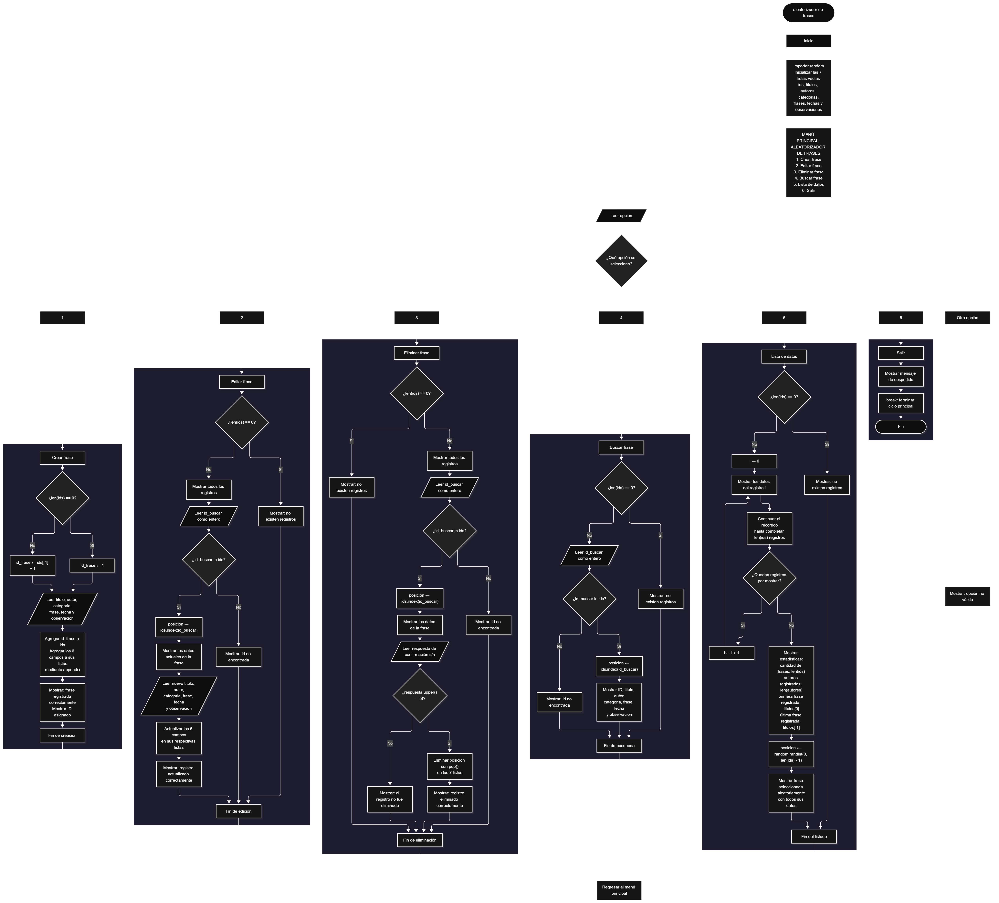

 

Este proyecto, llamado <b>aleatorizador de frases</b>, fue desarrollado en <b>python</b> como un ejercicio práctico para fortalecer la lógica de programación mediante la creación de un sistema de gestión de frases desde la consola. El programa cuenta con un menú principal de seis opciones que permite <b>crear, editar, eliminar, buscar y listar</b> las frases registradas, además de seleccionar una frase aleatoriamente. Cada registro almacena información como el título, el autor, la categoría, el contenido de la frase, la fecha y las observaciones, utilizando siete listas paralelas para organizar los datos durante la ejecución. Durante su desarrollo se aplicaron conceptos fundamentales de programación, como variables, listas, estructuras condicionales, ciclos repetitivos, operaciones con listas, búsqueda por identificador y generación de valores aleatorios mediante el módulo <b>random</b>. El proyecto también incorpora estadísticas básicas que muestran la cantidad de frases registradas, el número de autores asociados y los títulos que ocupan la primera y la última posición de la lista. Este ejercicio permite poner en práctica los conocimientos adquiridos en Python y sirve como base para desarrollar sistemas de gestión más avanzados.

<h2 align="center">⚙️ Funcionamiento del menú principal</h2>

### ➕ Crear frase

La opción <b>1) crear frase</b> permite registrar una nueva frase en el sistema. Antes de realizar el registro, el programa comprueba si la lista <b>ids</b> está vacía mediante la condición <b>len(ids) == 0</b>. Si no existen registros, asigna el identificador inicial <b>1</b> a la variable <b>id_frase</b>. En caso contrario, obtiene el último identificador almacenado y le suma uno mediante la expresión <b>ids[-1] + 1</b>. Después, solicita el <b>título, autor, categoría, contenido de la frase, fecha y observación</b>. Los datos se agregan a sus respectivas listas mediante el método <b>append()</b>, manteniendo la correspondencia entre las posiciones de las siete listas. Finalmente, muestra el mensaje <b>"frase registrada correctamente."</b> e informa el identificador asignado al registro. Esta operación permite incorporar nuevas frases a la colección mientras el programa permanece en ejecución.

### ✏️ Editar frase

La opción <b>2) editar frase</b> permite modificar la información de una frase registrada. Primero, el programa comprueba si existen registros mediante la condición <b>len(ids) == 0</b>. Si las listas están vacías, muestra el mensaje <b>"no existen registros."</b>. En caso contrario, presenta una lista con el identificador, título, autor, categoría, contenido de la frase, fecha y observación de cada registro. Después, solicita el identificador que se desea editar mediante la variable <b>id_buscar</b>, convirtiendo la entrada a un número entero con <b>int()</b>. El programa comprueba si el identificador pertenece a la lista <b>ids</b>. Si existe, utiliza <b>ids.index(id_buscar)</b> para obtener la posición correspondiente, muestra los datos actuales y solicita la nueva información de los seis campos descriptivos. Los valores se actualizan directamente en sus respectivas listas, mientras que el identificador permanece sin cambios. Finalmente, presenta el mensaje <b>"registro actualizado correctamente."</b>. Si el identificador no existe, muestra el mensaje <b>"id no encontrada."</b>.

### 🗑️ Eliminar frase

La opción <b>3) eliminar frase</b> permite eliminar una frase registrada mediante su identificador. Antes de iniciar el proceso, el programa comprueba si existen registros. Si no hay frases almacenadas, muestra el mensaje <b>"no existen registros."</b>. Si existen, presenta la lista de frases con todos sus datos y solicita el identificador del registro que se desea eliminar. A continuación, comprueba si el identificador se encuentra en <b>ids</b> y utiliza <b>ids.index(id_buscar)</b> para localizar su posición. Si encuentra el registro, muestra sus datos y solicita confirmación mediante la pregunta <b>"¿desea eliminar este registro? (s/n):"</b>. Cuando la respuesta convertida a mayúsculas mediante <b>respuesta.upper()</b> es igual a <b>"S"</b>, elimina la posición correspondiente de las siete listas mediante el método <b>pop()</b> y muestra el mensaje <b>"registro eliminado correctamente."</b>. Si la respuesta no es <b>"S"</b>, cancela la operación y presenta el mensaje <b>"el registro no fue eliminado."</b>. Si el identificador no existe, informa que no fue encontrado.

### 🔎 Buscar frase

La opción <b>4) buscar frase</b> permite localizar un registro utilizando su identificador. Primero, el programa comprueba si existen frases almacenadas. Si no hay registros, muestra el mensaje <b>"no existen registros."</b>. En caso contrario, solicita el identificador mediante la variable <b>id_buscar</b> y convierte el valor introducido a un número entero. Después, verifica si el identificador se encuentra en la lista <b>ids</b>. Si existe, utiliza <b>ids.index(id_buscar)</b> para obtener la posición del registro y muestra toda la información asociada: identificador, título, autor, categoría, contenido de la frase, fecha y observación. Si no encuentra el identificador, presenta el mensaje <b>"id no encontrada."</b>. Esta función facilita consultar una frase específica sin necesidad de recorrer manualmente toda la lista.

### 📋 Lista de datos

La opción <b>5) lista de datos</b> permite visualizar las frases registradas y consultar estadísticas básicas del sistema. Antes de mostrar la información, el programa comprueba si existen registros. Si las listas están vacías, presenta el mensaje <b>"no existen registros."</b>. Si hay frases disponibles, utiliza un ciclo <b>for</b> para recorrer las posiciones de las listas y mostrar los datos completos de cada registro. Después, presenta las estadísticas mediante las expresiones <b>len(ids)</b> y <b>len(autores)</b>, que indican la cantidad de frases y el número de posiciones ocupadas en la lista de autores, respectivamente. También muestra el título de la primera frase mediante <b>titulos[0]</b> y el de la última mediante <b>titulos[-1]</b>. Finalmente, utiliza el módulo <b>random</b> y la función <b>random.randint(0, len(ids) - 1)</b> para generar una posición aleatoria entre los registros existentes. Con esa posición, muestra los datos completos de la frase seleccionada aleatoriamente. Esta opción reúne el listado general, las estadísticas y la selección aleatoria en una misma operación.

### 🚪 Salir del menú principal

La opción <b>6) salir</b> permite finalizar la ejecución del programa. Cuando el usuario selecciona esta opción, el sistema muestra el mensaje <b>"gracias por utilizar el aleatorizador de frases."</b> y ejecuta la instrucción <b>break</b>, que interrumpe el ciclo principal <b>while True</b>. De esta manera, el menú deja de mostrarse y termina la ejecución del programa. Si el usuario introduce un valor que no corresponde a ninguna de las seis opciones, el bloque <b>else</b> muestra el mensaje <b>"opción no válida."</b> y el menú continúa disponible.

<h2 align="center">🧠 Temas aplicados en el proyecto</h2>

### 📦 Variables

En este proyecto se utilizan variables para controlar la opción seleccionada en el menú, asignar identificadores, almacenar temporalmente los datos introducidos por el usuario, localizar registros, guardar la respuesta de confirmación y seleccionar una frase aleatoria. Cada variable cumple una función específica dentro de las operaciones de gestión de frases.

🔢 **Opcion:** Almacena la opción seleccionada por el usuario en el menú principal.

🆔 **Id_frase:** Almacena el identificador asignado a una nueva frase.

🔎 **Id_buscar:** Almacena el identificador introducido por el usuario para editar, eliminar o buscar un registro.

📍 **Posicion:** Indica la posición de un registro dentro de las listas y se utiliza también para seleccionar una frase aleatoriamente.

📝 **Titulo, autor, categoria, frase, fecha y observacion:** Almacenan temporalmente los datos introducidos durante el registro de una frase.

🔄 **I:** Funciona como contador en los ciclos utilizados para recorrer y mostrar los registros.

✅ **Respuesta:** Almacena la confirmación introducida por el usuario antes de eliminar una frase.

### 🗃️ Listas

En este proyecto se utilizan siete listas paralelas para organizar la información de cada frase. Todas las listas comparten la misma posición para representar un registro completo. Por ejemplo, la información de una frase ubicada en la posición <b>0</b> se distribuye entre <b>ids[0], titulos[0], autores[0], categorias[0], frases[0], fechas[0] y observaciones[0]</b>. Esta organización permite agregar, consultar, modificar y eliminar registros manteniendo la correspondencia entre sus datos.

🆔 **Ids:** Almacena los identificadores de las frases registradas.

📝 **Titulos:** Almacena los títulos de las frases.

✍️ **Autores:** Almacena los autores asociados a las frases.

🗂️ **Categorias:** Almacena las categorías de las frases.

💬 **Frases:** Almacena el contenido de cada frase.

📅 **Fechas:** Almacena las fechas asociadas a los registros.

📄 **Observaciones:** Almacena las observaciones adicionales de cada frase.

### 🔀 Estructuras condicionales

En este proyecto se utilizan las estructuras <b>if, elif y else</b> para controlar las opciones del menú y determinar qué operación debe ejecutarse. También se emplean para comprobar si existen registros antes de realizar una operación, verificar si un identificador pertenece a la lista <b>ids</b>, confirmar la eliminación de una frase y mostrar un mensaje cuando la opción introducida no es válida. Estas condiciones permiten que el programa responda de acuerdo con el estado de los registros y las decisiones del usuario.

### 🔄 Estructuras repetitivas

El programa utiliza los ciclos <b>while True</b> y <b>for</b>. El ciclo <b>while True</b> mantiene activo el menú principal y permite realizar varias operaciones durante una misma ejecución hasta que el usuario selecciona la opción de salida. Los ciclos <b>for</b> permiten recorrer las listas para mostrar los registros existentes, tanto durante la edición y la eliminación como en la opción de listado general. De esta manera, el programa puede procesar todos los registros almacenados sin tener que escribir instrucciones independientes para cada frase.

### 🎯 Control del menú

El menú principal utiliza una cadena de condiciones <b>if, elif y else</b> para evaluar el valor de la variable <b>opcion</b>. Cada condición corresponde a una operación del sistema: <b>crear, editar, eliminar, buscar, listar o salir</b>. Si el valor introducido no coincide con ninguna opción definida, se ejecuta el bloque <b>else</b>, que muestra el mensaje <b>"opción no válida."</b>. Cuando se selecciona la opción 6, la instrucción <b>break</b> finaliza el ciclo principal.

### 🧮 Operaciones con listas

El programa utiliza distintos métodos y expresiones de Python para administrar los registros. El método <b>append()</b> incorpora los nuevos datos al final de las listas; <b>index()</b> permite encontrar la posición de un identificador; <b>pop()</b> elimina un elemento de una posición determinada; y <b>len()</b> calcula la cantidad de elementos almacenados. Además, utiliza la indexación <b>titulos[0]</b> para acceder al primer título y <b>titulos[-1]</b> para obtener el último. Estas operaciones permiten gestionar la colección de frases sin utilizar arreglos de tamaño fijo.

### 🎲 Módulo random

El programa importa el módulo <b>random</b> para realizar una selección aleatoria entre las frases registradas. Dentro de la opción de listado, la función <b>random.randint(0, len(ids) - 1)</b> genera un número entero que corresponde a una posición válida de las listas. El número obtenido se almacena en la variable <b>posicion</b> y se utiliza para mostrar los datos de la frase seleccionada. La selección solo se ejecuta cuando existen registros, por lo que el programa evita intentar elegir una posición aleatoria cuando las listas están vacías. Esta función selecciona una frase existente, pero no crea frases nuevas ni genera su contenido automáticamente.

### 🔢 Identificadores y posiciones

Cada frase recibe un identificador almacenado en la lista <b>ids</b>. Si no existen registros, el identificador inicial es <b>1</b>; en caso contrario, se calcula utilizando el último identificador almacenado más uno. Para localizar una frase, el programa comprueba si el identificador existe y utiliza <b>ids.index(id_buscar)</b> para obtener su posición. Esta posición permite acceder a los datos relacionados en las demás listas. El identificador no se modifica durante la edición, mientras que la eliminación retira los datos de la posición correspondiente en todas las listas.

<h2 align="center">¿Cómo se implementaron las operaciones crud en el proyecto?</h2>

Las operaciones <b>crud</b> se implementaron mediante las opciones del menú principal, permitiendo administrar las frases registradas durante la ejecución. La operación <b>crear</b> corresponde a <b>crear frase</b>, donde se solicitan los datos y se incorporan a las siete listas; <b>leer</b> se realiza mediante las opciones <b>buscar frase y lista de datos</b>, que permiten consultar un registro específico o visualizar la colección completa; <b>actualizar</b> corresponde a <b>editar frase</b>, donde se modifican los datos descriptivos de una frase existente; y <b>eliminar</b> se realiza mediante la opción <b>eliminar frase</b>, que solicita confirmación antes de retirar el registro. Estas operaciones utilizan identificadores, listas, condicionales y ciclos para gestionar la información almacenada temporalmente en memoria.

<h2 align="center">Diagrama de flujo del proyecto</h2>

<h2 align="center">🛡️ Validaciones del programa</h2>

### 📭 No existen registros

Esta comprobación se utiliza en las opciones de <b>editar, eliminar, buscar y lista de datos</b>. El programa evalúa la condición <b>len(ids) == 0</b> para determinar si hay frases registradas. Si la lista está vacía, muestra el mensaje <b>"no existen registros."</b> y evita continuar con una operación que necesita datos almacenados. En la opción de listado, esta comprobación también impide acceder a las posiciones de la primera y la última frase o realizar una selección aleatoria sin registros disponibles.

### ❌ Identificador no encontrado

Esta validación se utiliza durante las operaciones de <b>editar, eliminar y buscar frase</b>. El programa comprueba si el identificador introducido mediante <b>id_buscar</b> pertenece a la lista <b>ids</b>. Si existe, obtiene su posición con <b>ids.index(id_buscar)</b> y continúa con la operación correspondiente. Si no existe, muestra el mensaje <b>"id no encontrada."</b>. Esta comprobación evita intentar acceder a los datos de un identificador que no está registrado.

### ⚠️ Confirmación de eliminación

Antes de eliminar una frase, el programa muestra los datos del registro y solicita una confirmación mediante la variable <b>respuesta</b>. La condición <b>respuesta.upper() == "S"</b> permite aceptar tanto la letra <b>s</b> como la letra <b>S</b>. Si se cumple, el registro se elimina de las siete listas mediante <b>pop()</b>. Si la respuesta es cualquier otro valor, la operación se cancela y se muestra el mensaje <b>"el registro no fue eliminado."</b>. Esta comprobación evita que la eliminación se ejecute sin la confirmación esperada.

### 🔢 Conversión de identificadores

En las operaciones de edición, eliminación y búsqueda, el programa utiliza <b>int(input(...))</b> para convertir el identificador introducido por el usuario en un número entero. Esto permite compararlo con los valores almacenados en la lista <b>ids</b>. Sin embargo, el código no incluye un tratamiento de errores para entradas que no sean numéricas. Si el usuario introduce letras u otro valor incompatible con un entero, Python puede generar un error y detener la ejecución.

### ⚠️ Datos sin validación adicional

El programa solicita el título, autor, categoría, contenido de la frase, fecha y observación, pero no comprueba si estos campos están vacíos ni valida el formato de la fecha. Tampoco establece una cantidad máxima de registros ni verifica que los identificadores sean irrepetibles en todos los escenarios. El identificador nuevo se calcula sumando uno al último identificador de la lista, por lo que, si se elimina el registro con el identificador más alto, ese valor podría volver a utilizarse al crear una frase nueva.

### 💾 Almacenamiento temporal

La información se almacena en las listas mientras el programa está en ejecución. El código no implementa archivos, bases de datos ni otro mecanismo de persistencia. Por lo tanto, al finalizar el programa, los registros almacenados en memoria dejan de estar disponibles. Para conservar las frases entre diferentes ejecuciones sería necesario incorporar posteriormente un sistema de almacenamiento permanente.

<h2 align="center">🎯 Objetivo del proyecto</h2>

El objetivo principal de este proyecto es fortalecer la <b>lógica de programación</b> mediante el desarrollo de un sistema de gestión de frases en <b>python</b>. A través de su construcción se busca aplicar conocimientos sobre variables, listas, estructuras condicionales, ciclos repetitivos, operaciones con colecciones y selección aleatoria, integrándolos para resolver un problema de manera organizada. Además, el proyecto permite comprender cómo registrar, consultar, modificar y eliminar información, obtener estadísticas básicas y seleccionar aleatoriamente un elemento de una colección. De esta forma, constituye una base para desarrollar aplicaciones de consola más completas y ampliar posteriormente sus funcionalidades mediante almacenamiento permanente y validaciones adicionales.

